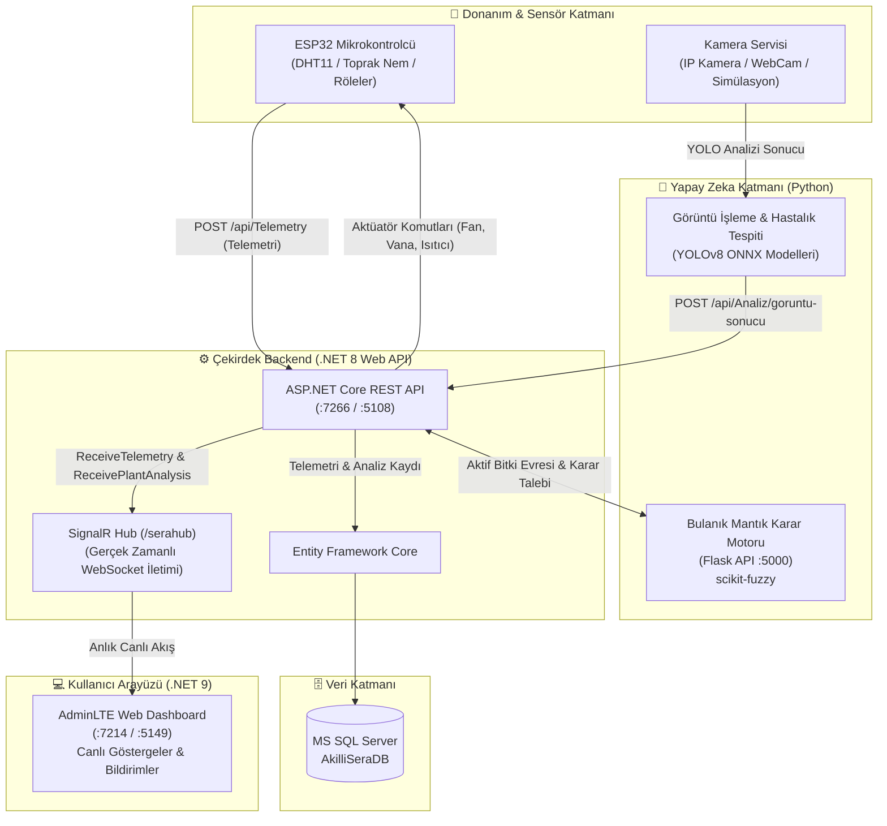

# 🌱 Akıllı Sera Otomasyonu (Smart Greenhouse IoT & AI Ecosystem)

[](https://dotnet.microsoft.com/)
[](https://www.python.org/)
[](https://flask.palletsprojects.com/)
[](https://ultralytics.com/)
[](https://www.espressif.com/)
[](https://www.microsoft.com/sql-server)
[](https://dotnet.microsoft.com/apps/aspnet/signalr)
[](LICENSE)

Endüstri 4.0 ve akıllı tarım vizyonuyla geliştirilmiş; **Gömülü Sistemler (ESP32)**, **Bulanık Mantık (Fuzzy Logic)**, **Derin Öğrenme ile Bilgisayarlı Görü (YOLOv8 / ONNX)**, **ASP.NET Core Web API**, **SignalR** ve **Modern Web Dashboard** bileşenlerini bir araya getiren uçtan uca otonom akıllı sera otomasyon ekosistemidir.

Bu proje, staj kapsamında çok disiplinli bir mühendislik ekibi tarafından tasarlanmış, modüler yapıda geliştirilmiş ve testleri başarıyla tamamlanmış çalışan bir tam kapsamlı sistemdir.

---

## 📑 İçindekiler
- [Proje Mimarisi ve Veri Akışı](#-proje-mimarisi-ve-veri-akışı)
- [Temel Yetenekler ve Modüller](#-temel-yetenekler-ve-modüller)
- [Teknoloji Yığını](#-teknoloji-yığını)
- [Proje Dizin Yapısı](#-proje-dizin-yapısı)
- [Hızlı Başlangıç ve Kurulum](#-hızlı-başlangıç-ve-kurulum)
  - [Ön Gereksinimler](#-ön-gereksinimler)
  - [Yöntem 1: Tek Komutla Otomatik Kurulum (Önerilen)](#-yöntem-1-tek-komutla-otomatik-kurulum-önerilen)
  - [Yöntem 2: Manuel Servis Başlatma](#-yöntem-2-manuel-servis-başlatma)
- [Uçtan Uca Doğrulama ve Test](#-uçtan-uca-doğrulama-ve-test)
- [Geliştirici Ekibi & Katkıda Bulunanlar](#-geliştirici-ekibi--katkıda-bulunanlar)
- [Lisans](#-lisans)

---

## 🏗️ Proje Mimarisi ve Veri Akışı

Sistem, mikrokontrolcü düzeyindeki telemetriden yapay zeka çıkarımlarına ve son kullanıcı web arayüzüne kadar mikroservis / modüler servis prensibiyle haberleşir:



---

## ✨ Temel Yetenekler ve Modüller

### 1. 🤖 Yapay Zeka & Bulanık Mantık Karar Motoru (`1_AI_Python`)
* **Bulanık Mantık (Fuzzy Logic):** Ortam sıcaklığı, ortam nemi, toprak nemi, günün saati ve bitkinin aktif büyüme evresi (`Tohum`, `Fide`, `Olgunlaşma`) parametrelerini değerlendirerek sulama süresi, havalandırma (fan) seviyesi ve ısıtıcı durumunu dinamik olarak belirler.
* **Görüntü İşleme & Hastalık Tespiti (YOLOv8 / ONNX):** Yaprak üzerindeki hastalıkları (ör. Erken Yanıklık vb.) ve domateslerin olgunluk durumlarını ONNX çalışma zamanında yüksek hızda tespit eder, sonuçları doğrudan backend servisine raporlar.

### 2. ⚙️ Kurumsal Backend REST API (`2_Backend_CSharp`)
* **Mimari:** .NET 8 Web API, Entity Framework Core, Service & Repository pattern.
* **Akıllı Entegrasyon:** Telemetri verisi geldiğinde SQL veritabanından seranın aktif bitki evresini çeker, Python Bulanık Mantık servisiyle iletişim kurar ve üretilen kararları hem veritabanına kaydeder hem de aktüatör komutu olarak ESP32'ye iletir.
* **Gerçek Zamanlı İletim:** SignalR Hub (`/serahub`) üzerinden tarayıcıları yenilemeye gerek kalmadan tüm sensör ve hastalık verilerini anlık yayınlar.
* **Dayanıklılık:** Python AI servisi çevrimdışı olsa dahi yerleşik fallback (güvenli eşik) mekanizması devreye girerek seranın güvenliğini sürdürür.

### 3. 🔌 Gömülü Sistemler & Donanım (`3_ESP32_Embedded`)
* **Donanım:** ESP32 geliştirme kartı, DHT sıcaklık/nem sensörleri, kapasitif toprak nem sensörleri ve 4'lü röle modülü (su vanası, ilaçlama vanası, fan, ısıtıcı).
* **İletişim:** Wi-Fi üzerinden REST API tüketimi ve periyodik sensör verisi iletimi.

### 4. 💻 Canlı Gösterge Paneli (`4_Frontend_Web`)
* **Arayüz:** ASP.NET Core 9 Razor Pages ve AdminLTE 3 entegrasyonu.
* **Canlı Takip:** SignalR dinleyicileriyle donatılmış sensör kartları, telemetri grafik sayfaları, gerçek zamanlı bildirim merkezi ve hastalık tespit uyarıları.

### 5. 🗄️ İlişkisel Veritabanı Mimarisi (`5_Veritabanı_SQL`)
* **MS SQL Server:** Referans tabloları (`Bitki_Evreleri`, `Sera_Durum`), dinamik telemetri ve eylem logları (`Sensor_Loglari`, `Aksiyon_Loglari`, `Kamera_Loglari`), kullanıcı yönetimi, bildirimler ve stored procedure altyapısı.

---

## 🧰 Teknoloji Yığını

| Alan | Teknolojiler |
| :--- | :--- |
| **Backend API** | C#, .NET 8, ASP.NET Core Web API, Entity Framework Core, SignalR, Swagger/OpenAPI |
| **Yapay Zeka & Görüntü** | Python 3.11+, Scikit-Fuzzy, OpenCV, Ultralytics YOLOv8, ONNX Runtime, Flask REST API |
| **Gömülü Sistem (IoT)** | C++, ESP32 (Espressif), Arduino Core / PlatformIO, HTTPClient, ArduinoJson |
| **Web Arayüzü** | .NET 9 Razor Pages, AdminLTE 3, Bootstrap 5, JavaScript, Chart.js |
| **Veritabanı** | Microsoft SQL Server / LocalDB, T-SQL |
| **Otomasyon** | PowerShell Kurulum ve Entegrasyon Betikleri |

---

## 📁 Proje Dizin Yapısı

```
AkilliSera/
├── 1_AI_Python/              # Yapay Zeka servisleri
│   ├── Bulanik_Mantik/       # Bulanık mantık (Fuzzy Logic) karar motoru (Flask API)
│   ├── Goruntu_Isleme/       # ONNX / YOLOv8 hastalık ve meyve tespit modelleri & kamera servisi
│   └── requirements.txt      # Python bağımlılıkları
├── 2_Backend_CSharp/         # .NET 8 Web API ve SignalR Hub
│   ├── Controllers/          # Telemetry, Analiz, Bildirim, BitkiEvre, vb. API uç noktaları
│   ├── Hubs/                 # SignalR gerçek zamanlı iletişim hub'ı (SeraHub)
│   ├── Services/             # Fuzzy entegrasyonu, veritabanı ve sağlık kontrol servisleri
│   └── Models/               # Veritabanı ve DTO veri modelleri
├── 3_ESP32_Embedded/         # ESP32 C++ gömülü yazılım kaynak kodları
├── 4_Frontend_Web/           # .NET 9 Web Paneli (AdminLTE Razor Pages)
│   ├── Pages/                # Dashboard, Sensörler, Hastalıklar, Grafikler ve Bildirimler sayfaları
│   └── wwwroot/              # Stil, script ve kütüphane varlıkları
├── 5_Veritabanı_SQL/         # Sıralı MS SQL Server şema ve başlangıç verisi scriptleri
├── Docs_Donanim/             # Donanım pin şemaları ve teknik çizimler
└── setup-all.ps1             # Tüm ortamı otomatik kuran PowerShell betiği
```

---

## 🚀 Hızlı Başlangıç ve Kurulum

### 📋 Ön Gereksinimler
Sistemi yerel ortamda çalıştırmak için aşağıdaki araçların kurulu olması yeterlidir:
* **Git**
* **.NET SDK (8.0 ve 9.0)** (`dotnet --list-sdks`)
* **Python 3.11+** (`python --version`)
* **MS SQL Server** (SQL Express veya LocalDB)

---

### ⚡ Yöntem 1: Tek Komutla Otomatik Kurulum (Önerilen)

Tüm Python kütüphanelerini yükleyen, SQL Server üzerinde `AkilliSeraDB` veritabanını oluşturup tabloları basan ve .NET projelerini derleyen hazır kurulum betiği mevcuttur:

1. Depoyu klonlayın ve kök dizine gidin:
   ```bash
   git clone https://github.com/OryazStaj/AkilliSera.git
   cd AkilliSera
   ```

2. PowerShell üzerinde tek komutla kurulumu tamamlayın:
   ```powershell
   .\setup-all.ps1
   ```

---

### 🛠️ Yöntem 2: Manuel Servis Başlatma

Sistemi uçtan uca çalıştırmak için **3 ayrı terminal** penceresi açın:

#### 1️⃣ Terminal: Bulanık Mantık (AI Karar Motoru)
```powershell
cd 1_AI_Python
python Bulanik_Mantik/fuzzy_sistem.py
```
> Servis `http://localhost:5000` adresinde dinlemeye başlar.

#### 2️⃣ Terminal: Backend REST API
```powershell
cd 2_Backend_CSharp
dotnet run --launch-profile https
```
> API `https://localhost:7266` ve `http://localhost:5108` adreslerinde ayağa kalkar.
> Swagger Arayüzü: `https://localhost:7266/swagger`

#### 3️⃣ Terminal: Web Arayüzü (Frontend)
```powershell
cd 4_Frontend_Web
dotnet run --launch-profile https
```
> Web Paneli `https://localhost:7214` adresinde çalışır. Tarayıcınızda açıp kontrol edebilirsiniz.

---

## 🧪 Uçtan Uca Doğrulama ve Test

Fiziksel ESP32 kartı bağlı olmasa dahi, sistemi simüle etmek için yeni bir terminalde şu komutla sanal sensör telemetrisi yollayabilirsiniz:

```powershell
$testTelemetri = @{
    SeraId = 1
    OrtamSicakligi = 34.0
    OrtamNemi = 40.0
    ToprakNemi = 25.0
} | ConvertTo-Json

Invoke-RestMethod -Uri "https://localhost:7266/api/telemetry" `
    -Method POST `
    -ContentType "application/json" `
    -Body $testTelemetri `
    -SkipCertificateCheck
```

### 🎯 Neler Gerçekleşir?
1. **Bulanık Mantık Devreye Girer:** Backend, Python AI servisine danışır; yüksek sıcaklık ve kuru toprak için sulama ve fan açma kararı alır.
2. **SQL Veritabanı Güncellenir:** Sensör okuması ve üretilen aksiyon anında loglanır.
3. **Web Paneli Canlı Güncellenir:** SignalR sayesinde `https://localhost:7214/sensorler` sayfasındaki aktüatör kartları ve sensör göstergeleri sayfa yenilenmeden canlı olarak aktifleşir!

---

## 👥 Geliştirici Ekibi & Katkıda Bulunanlar

Bu proje, staj sürecinde ortak havuzda takım çalışması prensibiyle geliştirilmiştir:

| Katkıda Bulunan | Çalışma Alanı | Profil Bağlantısı |
| :--- | :--- | :--- |
| **Geliştirici Adı** | Yapay Zeka & Görüntü İşleme (Python, YOLOv8, Fuzzy Logic) | [](https://github.com/) |
| **Geliştirici Adı** | Backend Mimarisi & SignalR Entegrasyonu (.NET 8, C#, MSSQL) | [](https://github.com/) |
| **Geliştirici Adı** | Web Arayüzü & Kullanıcı Deneyimi (.NET 9 Razor, AdminLTE) | [](https://github.com/) |
| **Geliştirici Adı** | Gömülü Sistemler & Donanım (ESP32, C++, IoT Sensörler) | [](https://github.com/) |
| **Geliştirici Adı** | Veritabanı Tasarımı & SQL Mimarisi (MS SQL Server, T-SQL) | [](https://github.com/) |

*(Ekip üyeleri kendi isimlerini ve GitHub/LinkedIn profil bağlantılarını yukarıdaki tabloya ekleyebilir.)*

---

## 📄 Lisans

Bu proje [MIT Lisansı](LICENSE) kapsamında açık kaynak olarak paylaşılmıştır.
